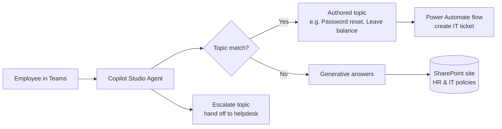

# Copilot Studio HR & IT Helpdesk Agent


An AI agent built with **Microsoft Copilot Studio** that answers employee questions about **HR policies, IT support and company procedures**, using a SharePoint site as its knowledge source. Deployed to Microsoft Teams.

> Demo agent with fictional policy documents (see `/knowledge-samples`). Based on an agent I built for an enterprise; no client content is included.

## 🏗️ Architecture



## 💬 What it can do

| Scenario | How it's handled |
|---|---|
| "How many days of annual leave do I get?" | Generative answer from the Leave Policy page, with citation |
| "How do I reset my password?" | Authored topic with step-by-step guidance |
| "My laptop won't connect to VPN" | Topic collects details → flow creates an IT ticket → returns ticket number |
| "What's the work-from-home policy?" | Generative answer from SharePoint |
| Anything it can't answer | Escalation topic with helpdesk contact |

## 🧩 Topic Design

See [`docs/topic-design.md`](topic-design.md) for trigger phrases, variables and conversation flow of each topic.

## 🔐 Configuration

- **Authentication:** Microsoft Entra ID (users only see SharePoint content they already have permission to)
- **Knowledge source:** SharePoint site URL with HR and IT pages/documents
- **Content moderation:** Medium; answers grounded only in knowledge sources (general knowledge off)
- **Channel:** Microsoft Teams

## 🧪 Testing

[`docs/test-cases.md`](test-cases.md) lists the questions used to validate accuracy, citations and fallbacks before publishing.

## 📁 Structure

```
├── docs/
│   ├── topic-design.md
│   └── test-cases.md
├── knowledge-samples/     # Fictional policy docs to upload to SharePoint
│   ├── leave-policy.md
│   └── it-support-guide.md
└── solution/              # Exported agent solution (unpacked)
```

## 👤 Author

**Pavan Reddy Cheedeti** — Power Platform Developer · [LinkedIn](https://www.linkedin.com/in/pavan-reddy-ch-a960b7439/)
